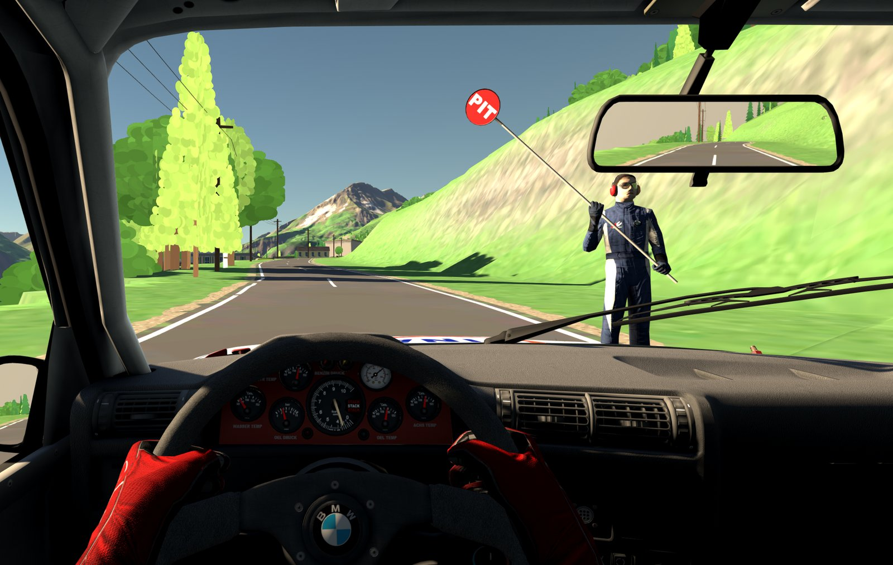
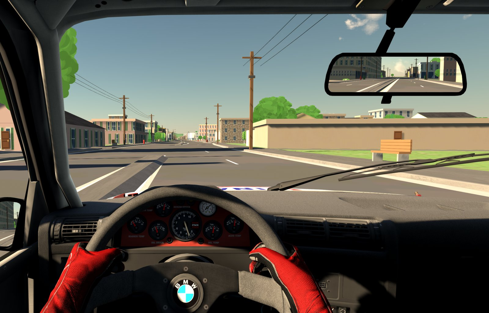

# Map2Lap

**Real roads for Assetto Corsa.** Pick a route on a map – or draw an area – and Map2Lap builds a drivable Assetto
Corsa track from real-world data: lidar terrain, real roads with bridges and tunnels, buildings, water and trees, in a
comic style. The track is installed straight into Assetto Corsa.




Built on the world generator of [BeamNG.Earth](https://github.com/TecnaGamer/BeamNG.Earth) by TecnaGamer.

## Quick start

1. Download `Map2Lap-<version>-win64.zip` from [Releases](../../releases) and unzip it.
2. Double-click **`Start Map2Lap.bat`** – the generator page opens in your browser.
3. Click a start and a finish on the map, then **Build track**. When it's done, click **▶ Play**.

**You need:** Windows 10/11 64-bit, [Assetto Corsa](https://store.steampowered.com/app/244210/Assetto_Corsa/) on
Steam, an internet connection, 16 GB RAM recommended. [Content Manager](https://acstuff.club/app/) and
[Custom Shaders Patch](https://acstuff.club/patch/) are recommended (animated water needs CSP).

## Features

- **Route or area:** routes follow real roads (with waypoints) and build a corridor along them; areas build everything
  inside a rectangle.
- **A complete world:** terrain, roads, bridges, tunnels, buildings, street furniture, guardrails, pylons, rivers and
  lakes, trees, rocks, fields – plus distant terrain up to 40 km.
- **Timing:** routes get a start line, a finish line and START/FINISH gantries, timed like a rally stage.
- **My tracks:** rebuild a track with the latest version, build a copy, delete it, or **▶ Play** it straight away.

Short routes (2–20 km) work best: Assetto Corsa loads the whole track at once.

## Troubleshooting

| Problem | What to do |
|---|---|
| Windows warns about running the file | The release isn't signed: *More info → Run anyway*. |
| Assetto Corsa isn't found | **Settings** → choose your `assettocorsa` folder. |
| The page doesn't open / port in use | Map2Lap is already running – use that window, or close it and start again (http://localhost:8800). |
| A build fails | See the build log. Usually the map data couldn't be downloaded: check the connection and try again. |
| A new track is missing in Content Manager | Restart Content Manager. |

Found a broken road or bridge? Please open an issue with the coordinates. Easiest: **Settings → Testing → Track Debug
app**, press **F10** at the spot while driving and attach that session's folder from
`Documents\Assetto Corsa\map2lap_debug` (the marks, the drive around each, a screenshot of each, and what it takes to
build the same track again).

To share a track, copy its **track code** from the status card (under **My tracks**, or under **New track** as soon
as the route is set); the other person pastes it into the same field under **New track** and builds it.

## Development

```powershell
py -3.12 -m venv .venv
.venv\Scripts\python.exe -m pip install -r requirements.txt
.venv\Scripts\python.exe tools\get_textures.py
"Start Map2Lap.bat"
```

How it works, tools and releases: [docs/DEVELOPMENT.md](docs/DEVELOPMENT.md).

## Credits

| | Source | Licence |
|---|---|---|
| World generator | [BeamNG.Earth](https://github.com/TecnaGamer/BeamNG.Earth) by TecnaGamer | MIT |
| Map data | © [OpenStreetMap](https://www.openstreetmap.org/copyright) contributors, [Overture Maps Foundation](https://overturemaps.org/) | ODbL |
| Elevation | [Mapterhorn](https://mapterhorn.com/attribution), AWS Terrain Tiles | per source |
| Land cover | © ESA WorldCover project 2021, contains modified Copernicus Sentinel data | CC BY 4.0 |
| Tree heights | Meta and World Resources Institute | CC BY 4.0 |
| Routes, place names | [OSRM](https://project-osrm.org/), [Nominatim](https://nominatim.org/) | usage policies |
| Textures | [ambientCG](https://ambientcg.com/) | CC0 |

Tracks you build contain this data; the attribution is written into each track's description.

## License

[MIT](LICENSE). BeamNG.Earth in `vendor/beamng_earth` keeps its own MIT License. Map2Lap is a fan project and not
affiliated with Kunos Simulazioni, BeamNG GmbH or the BeamNG.Earth project.
